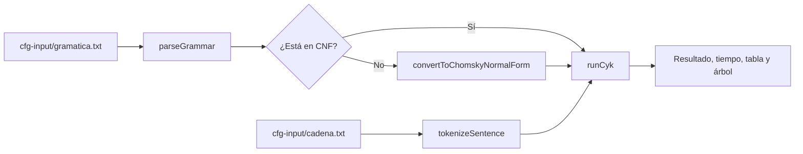

# Parser CYK para Gramáticas Libres de Contexto (CFG)

**Curso:** Teoría de la Computación — Octubre 2026

**Integrantes:**

- Adrian Penagos
- Oscar Rompich
- Wilson Arodi

Implementación en TypeScript del algoritmo Cocke-Younger-Kasami (CYK) con programación dinámica. Determina si una frase pertenece al lenguaje generado por una CFG, reporta el tiempo de ejecución y construye el árbol de derivación (parse tree).

**Demo del proyecto:** <https://cfg.rompich.me>

## 1. Requisitos y Ejecución

```sh
pnpm install # Instalar dependencias
pnpm run cfg # Ejecutar parser usando archivos en cfg-input/
pnpm test    # Ejecutar pruebas (44/44 pasando)
```

## 2. Flujo y Arquitectura

### Flujo general



### Archivos de la interfaz gráfica

```text
src/
├── routes/
│   └── +page.svelte
└── features/
    └── cfg-parser/
        ├── CFG.svelte
        ├── components/
        │   ├── Grammar.svelte
        │   ├── GrammarContainer.svelte
        │   ├── CYKRunner.svelte
        │   └── ParseTree.svelte
        └── utils/
            └── grammar-format.ts
```

### Archivos de algoritmos

```text
src/features/cfg-parser/algorithms/
├── grammar-reader.ts
├── cnf-validator.ts
├── cfg_minimization.ts
├── sentence-tokenizer.ts
└── cyk.ts
```

Módulos (`src/features/cfg-parser/algorithms/`):

- `grammar-reader.ts`: Parsea texto a la estructura `Grammar`. Interpreta `ε` o `e` como vacío.
- `cnf-validator.ts`: Verifica si la gramática cumple la Forma Normal de Chomsky (CNF).
- `cfg_minimization.ts`: Transforma gramáticas a CNF mediante un proceso funcional e inmutable:

  1. Adición de nuevo símbolo inicial si S es anulable y recursivo.
  2. Eliminación de transiciones `ε` (anulables).
  3. Eliminación de producciones unitarias (`A -> B`).
  4. Eliminación de símbolos inútiles (generativos e inalcanzables).
  5. Binarización y aislamiento de terminales (`BIN_n`, `TERM_n`). Reutiliza no terminales solo si su regla única es `A -> t`.
- `sentence-tokenizer.ts`: Normaliza a minúsculas, unifica espacios en blanco y remueve puntuación (`. , ; : ? !`). Mantiene palabras desconocidas intactas para que CYK las procese.
- `cyk.ts`: Ejecución de CYK (`O(n^3 * |G|)` tiempo, `O(n^2)` espacio). Construye concurrentemente un único parse tree (suficiente ante gramáticas ambiguas).
- `scripts/terminal.ts`: Punto de entrada CLI y medición de rendimiento.

## 3. Entrada y Salida

- **Gramática** (`cfg-input/gramatica.txt`): Formato `A -> B C | x`. La gramática provista ya se encuentra en CNF.
- **Cadena** (`cfg-input/cadena.txt`): Texto libre. Si queda vacío tras tokenizar, el programa termina con advertencia.

Ejemplo de salida CLI (`pnpm run cfg`):

```text
Frase: The cat drinks the beer.
Tokens: the cat drinks the beer

=== RESULTADO ===
SÍ
Tiempo de ejecución CYK: 0.583 ms

Árbol sintáctico:
S
├── NP [the cat]
│   ├── Det [the]
│   └── N [cat]
└── VP [drinks the beer]
    ├── V [drinks]
    └── NP [the beer]
        ├── Det [the]
        └── N [beer]
```

## 4. Pruebas y Resultados

Tiempos obtenidos promediando 2000 ejecuciones con la gramática base:

| Frase | Resultado | Tiempo promedio | Notas |
| --- | :---: | ---: | --- |
| The cat drinks the beer. | SÍ | 0.009 ms | Estructura transitiva estándar. |
| She eats a cake with a fork; | SÍ | 0.063 ms | Adjunto preposicional (`VP -> VP PP`). |
| she eats | SÍ | 0.004 ms | Caso intransitivo mínimo. |
| She eats pizza | NO | — | `pizza` es terminal ajeno a la gramática. |
| Cake the eats she | NO | — | Sintaxis incorrecta. |
| she eats a cake with | NO | — | Sintagma preposicional incompleto. |

## 5. Limitaciones y Notas Técnicas

- **Reservas de léxico:** El carácter `e` está reservado exclusivamente para representar `ε`; no puede emplearse como terminal.
- **Tokenización continua:** La puntuación se elimina sin sustituir por espacio (`cat,dog -> catdog`).
- **Modo CLI estático:** La entrada se lee únicamente desde archivos en disco.
