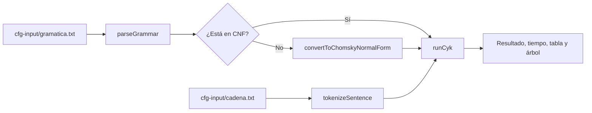

# Parser CYK para Gramáticas Libres de Contexto (CFG)

**Curso:** Teoría de la Computación — Octubre 2026

**Integrantes:**

- Adrian Penagos
- Oscar Rompich
- Wilson Arodi

Implementación en TypeScript del algoritmo Cocke-Younger-Kasami (CYK) con programación dinámica. Determina si una frase pertenece al lenguaje generado por una gramática libre de contexto (CFG), reporta el tiempo de ejecución y construye el árbol de derivación (parse tree).

**Demo del proyecto:** <https://cfg.rompich.me>

## 1. Descripción y ejecución

La aplicación:

1. Lee la gramática y la convierte a Forma Normal de Chomsky (CNF) si es necesario.
2. Normaliza y tokeniza la frase ingresada.
3. Ejecuta el algoritmo CYK.
4. Muestra **SÍ** o **NO**, el tiempo de ejecución, la tabla CYK y, si la frase es aceptada, el árbol sintáctico.

Para ejecutar el proyecto:

```sh
pnpm install # Instalar dependencias
pnpm run cfg # Ejecutar parser usando archivos en cfg-input/
pnpm test    # Ejecutar pruebas (44/44 pasando)
```

## 2. Flujo y Arquitectura

### Flujo general



### Archivos de la interfaz gráfica

```text
src/
├── routes/
│   └── +page.svelte
└── features/
    └── cfg-parser/
        ├── CFG.svelte
        ├── components/
        │   ├── Grammar.svelte
        │   ├── GrammarContainer.svelte
        │   ├── CYKRunner.svelte
        │   └── ParseTree.svelte
        └── utils/
            └── grammar-format.ts
```

### Archivos de algoritmos

```text
src/features/cfg-parser/algorithms/
├── grammar-reader.ts
├── cnf-validator.ts
├── cfg_minimization.ts
├── sentence-tokenizer.ts
└── cyk.ts
```

### Responsabilidad de los módulos

| Archivo | Responsabilidad |
| --- | --- |
| `grammar-reader.ts` | Convierte reglas como `A -> B C` o `A -> x` en una estructura `Grammar`. Acepta `ε` o `e` como épsilon. |
| `cnf-validator.ts` | Comprueba si la gramática está en CNF y detalla las producciones que la violan. |
| `cfg_minimization.ts` | Simplifica la gramática y la convierte a CNF sin modificar la entrada. |
| `sentence-tokenizer.ts` | Convierte a minúsculas, elimina `. , ; : ? !`, unifica espacios y conserva palabras desconocidas, paréntesis y operadores. |
| `cyk.ts` | Construye la tabla CYK, decide la pertenencia y genera un árbol sintáctico. |

El archivo `scripts/terminal.ts` conecta estos módulos, lee los archivos de entrada, mide el tiempo de CYK y presenta el resultado en la terminal.

### Estructuras de datos principales

- `Grammar`: contiene `startSymbol`, las `productions` y los conjuntos `nonTerminals` y `terminals`.
- `CykTable`: es una matriz de conjuntos. `table[length - 1][start]` contiene los no terminales que generan el fragmento de esa longitud y posición inicial.
- `ParseTreeNode`: contiene `symbol`, `children` y, opcionalmente, `terminal`.
- `CykResult`: contiene `isAccepted`, `tokens`, `table` y `parseTree`. El árbol es `null` cuando la cadena se rechaza.

## 3. Simplificación de la gramática

`convertToChomskyNormalForm` aplica estos pasos en orden y conserva el resultado intermedio de cada uno:

1. **Eliminar producciones épsilon.** Calcula los símbolos anulables y genera las variantes necesarias de cada producción.
2. **Eliminar producciones unitarias.** Sustituye cada producción `A -> B` por las producciones alcanzables desde `B`.
3. **Eliminar símbolos inútiles.** Descarta símbolos no generativos o inalcanzables desde el símbolo inicial.
4. **Convertir a CNF.** Aísla terminales de producciones largas mediante símbolos `TERM`, `TERM_1`, etc., y divide producciones de más de dos símbolos mediante `BIN`, `BIN_1`, etc.

Si el símbolo inicial es anulable y aparece en un lado derecho, antes del primer paso se crea un símbolo inicial nuevo, por ejemplo `START -> S`. Esto permite conservar `START -> ε` sin infringir las reglas de CNF.

Un no terminal existente se reutiliza para aislar un terminal únicamente cuando su única producción es `A -> t`. Reutilizar uno con producciones adicionales ampliaría el lenguaje. Los nombres auxiliares nunca chocan con símbolos existentes y ninguna etapa modifica la gramática recibida.

### Ejemplo de conversión

La gramática aritmética de `tests/fixtures/1.txt` todavía no está en CNF:

```text
E -> T X
X -> + T X | ε
T -> F Y
Y -> * F Y | ε
F -> ( E ) | id
```

Las producciones `X -> + T X`, `X -> ε`, `Y -> * F Y`, `Y -> ε` y `F -> ( E )` violan CNF. Después de convertirla se obtienen 20 producciones válidas:

```text
E -> T X | F Y | TERM BIN | id
X -> TERM_2 BIN_1 | TERM_2 T
T -> F Y | TERM BIN | id
Y -> TERM_3 BIN_2 | TERM_3 F
F -> TERM BIN | id
TERM -> (
TERM_1 -> )
TERM_2 -> +
TERM_3 -> *
BIN -> E TERM_1
BIN_1 -> T X
BIN_2 -> F Y
```

La gramática principal de `cfg-input/gramatica.txt` tiene 30 producciones y ya está en CNF, por lo que el programa omite la conversión y la utiliza directamente.

## 4. Algoritmo CYK

CYK usa programación dinámica para almacenar los no terminales que generan cada fragmento y evitar cálculos repetidos. Para una frase de `n` tokens:

1. **Longitud 1:** para cada token `w_i`, agrega a la celda todo `A` para el que exista `A -> w_i`.
2. **Longitudes de 2 a n:** prueba cada punto de división. Si `B` genera el fragmento izquierdo, `C` el derecho y existe `A -> B C`, agrega `A` a la celda.
3. La frase se acepta cuando el símbolo inicial aparece en `table[n - 1][0]`.

La complejidad es `O(n^3 * |G|)` en tiempo y `O(n^2)` celdas en espacio. `runCyk` también contempla la cadena vacía: solo la acepta si existe una producción inicial hacia `ε`. El modo CLI avisa y termina antes de ejecutar CYK cuando el archivo de entrada queda vacío después de tokenizar.

### Construcción del árbol sintáctico

Mientras llena la tabla, el algoritmo mantiene una tabla paralela de subárboles. Una producción terminal crea un nodo con el token como hoja; una producción binaria conecta los subárboles izquierdo y derecho. Si la frase se acepta, la raíz se obtiene de la celda final del símbolo inicial.

En una gramática ambigua puede haber varias derivaciones. La implementación conserva el primer árbol encontrado para cada símbolo y celda, por lo que devuelve un solo árbol.

Por ejemplo, `She eats a cake with a fork;` produce el siguiente árbol. La regla `VP -> VP PP` muestra que `with a fork` modifica al sintagma verbal `eats a cake`:

```text
S
├── NP
│   └── she
└── VP
    ├── VP
    │   ├── V
    │   │   └── eats
    │   └── NP
    │       ├── Det
    │       │   └── a
    │       └── N
    │           └── cake
    └── PP
        ├── P
        │   └── with
        └── NP
            ├── Det
            │   └── a
            └── N
                └── fork
```

### Ejemplo de la tabla CYK

Para `The cat drinks the beer.`, los tokens son `the cat drinks the beer`. La frase se acepta porque la celda de longitud 5 contiene `S`. El token `drinks` produce tanto `VP` como `V`.

```text
Longitud 1:
[the] = {Det}
[cat] = {N}
[drinks] = {VP, V}
[the] = {Det}
[beer] = {N}

Longitud 2:
[the cat] = {NP}
[cat drinks] = {∅}
[drinks the] = {∅}
[the beer] = {NP}

Longitud 3:
[the cat drinks] = {S}
[cat drinks the] = {∅}
[drinks the beer] = {VP}

Longitud 4:
[the cat drinks the] = {∅}
[cat drinks the beer] = {∅}

Longitud 5:
[the cat drinks the beer] = {S}
```

## 5. Entrada y salida

- **Gramática:** `cfg-input/gramatica.txt`, con una regla por línea y alternativas separadas por `|`.
- **Cadena del modo CLI:** `cfg-input/cadena.txt`, en texto libre.
- **Interfaz web:** permite editar la gramática y la frase directamente.

Antes de ejecutar CYK, `tokenizeSentence` convierte a minúsculas, elimina la puntuación admitida y trata cualquier secuencia de espacios, tabulaciones o saltos de línea como un solo separador.

| Entrada | Tokens |
| --- | --- |
| `She eats a cake with a fork;` | `she eats a cake with a fork` |
| `The cat drinks the beer.` | `the cat drinks the beer` |

Las palabras desconocidas no se eliminan: llegan a CYK y normalmente provocan el rechazo. Los paréntesis y operadores como `+` y `*` también se conservan.

Ejemplo abreviado de salida CLI (`pnpm run cfg`):

```text
Frase: The cat drinks the beer.
Tokens: the cat drinks the beer

=== RESULTADO ===
SÍ
Tiempo de ejecución CYK: 0.583 ms

Árbol sintáctico:
S
  NP
    Det
      the
    N
      cat
  VP
    V
      drinks
    NP
      Det
        the
      N
        beer
```

Las hojas del árbol, leídas de izquierda a derecha, coinciden con los tokens de la frase. El tiempo cambia entre ejecuciones.

## 6. Pruebas y resultados

Los tiempos siguientes son promedios de 2000 ejecuciones consecutivas de `runCyk` con la gramática principal. Una ejecución en frío suele ser más lenta por el calentamiento del motor de JavaScript.

### Frases aceptadas

| Frase | Resultado | Tiempo promedio |
| --- | :---: | ---: |
| `She eats a cake with a fork;` | SÍ | 0.063 ms |
| `The cat drinks the beer.` | SÍ | 0.009 ms |
| `He cuts the cake with a knife in the oven` | SÍ | 0.019 ms |
| `The dog cuts the meat with a spoon.` | SÍ | 0.013 ms |
| `she eats` | SÍ | 0.004 ms |
| `a cat eats` | SÍ | 0.005 ms |

### Frases rechazadas

| Frase | Resultado | Motivo |
| --- | :---: | --- |
| `She eats pizza` | NO | `pizza` no pertenece al léxico de la gramática. |
| `Cake the eats she` | NO | El orden sintáctico es incorrecto. |
| `the cat the dog` | NO | No contiene un verbo que permita formar la oración. |
| `she eats a cake with` | NO | La preposición no tiene un sintagma nominal completo. |

### Pruebas automáticas

| Archivo | Qué comprueba |
| --- | --- |
| `grammar-reader.test.ts` | Lectura de gramáticas y errores de sintaxis. |
| `cnf-validator.test.ts` | Detección de producciones que violan CNF. |
| `cfg-minimization.test.ts` | Simplificación, conversión a CNF e inmutabilidad. |
| `cyk.test.ts` | Aceptación, rechazo, tabla, tokens desconocidos, cadena vacía y validación de CNF. |
| `sentence-tokenizer.test.ts` | Mayúsculas, puntuación, espacios, entrada vacía, símbolos conservados e integración con CYK. |

`pnpm test` ejecuta 44 pruebas con `node:test`.

## 7. Decisiones y limitaciones

### Decisiones relevantes

- **Tokenización separada:** mantiene a CYK independiente del formato del texto y permite probar la normalización por separado.
- **Palabras desconocidas:** se conservan para que CYK las rechace, en lugar de alterar silenciosamente la entrada.
- **Símbolos auxiliares:** las gramáticas convertidas pueden mostrar nodos `TERM` y `BIN` en la tabla o el árbol.
- **Un árbol por resultado:** se almacena un subárbol por símbolo y celda; las derivaciones alternativas se descartan.
- **Aislamiento seguro de terminales:** solo se reutiliza un no terminal cuya única regla produce ese terminal. Así se evita ampliar accidentalmente el lenguaje durante la conversión.

Esta última restricción evita un error concreto: en `S -> A A | a B`, `A -> a | b b` y `B -> b`, reutilizar `A` para aislar el terminal `a` haría que la gramática convertida aceptara incorrectamente `b b b`. La implementación actual crea un símbolo `TERM` independiente y conserva el lenguaje original.

Por ejemplo, la gramática ambigua `S -> S S | a` tiene más de una derivación para algunas cadenas. El programa acepta la cadena cuando corresponde, pero presenta únicamente el primer árbol construido.

### Limitaciones

- El carácter `e` está reservado para representar `ε` y no puede usarse como terminal.
- La puntuación `. , ; : ? !` se elimina sin insertar espacios; por ejemplo, `cat,dog` se convierte en `catdog`.
- El modo CLI solo lee la gramática y la cadena desde archivos. La interfaz web sí permite editarlas directamente.
- CYK requiere una gramática en CNF; si se llama `runCyk` directamente con otra forma, lanza un error con las producciones inválidas.

### Recomendaciones

- Validar o convertir la gramática antes de ejecutar CYK.
- Probar una conversión compleja con una gramática pequeña antes de utilizar una de mayor tamaño.
- Promediar varias ejecuciones cuando se compare rendimiento, porque la primera suele ser más lenta.
